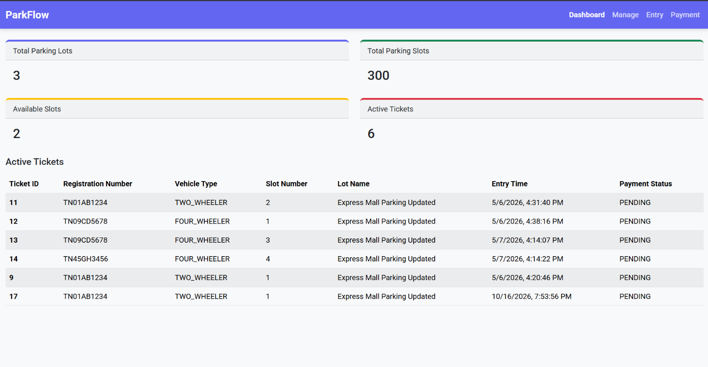
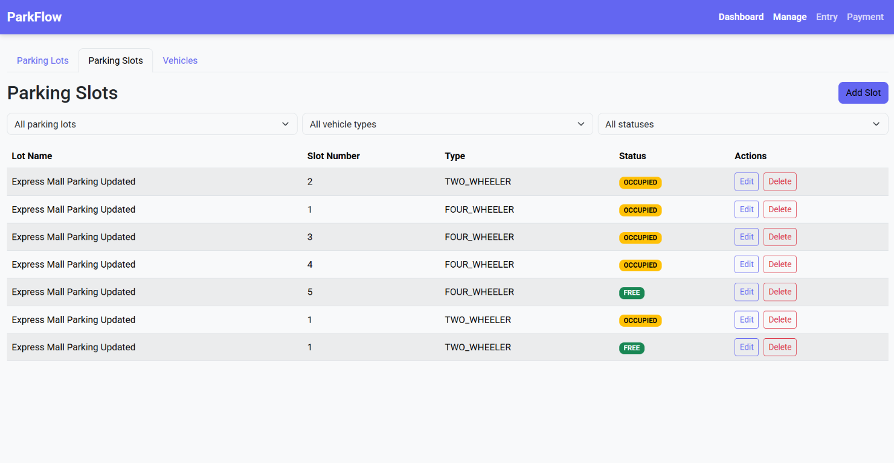
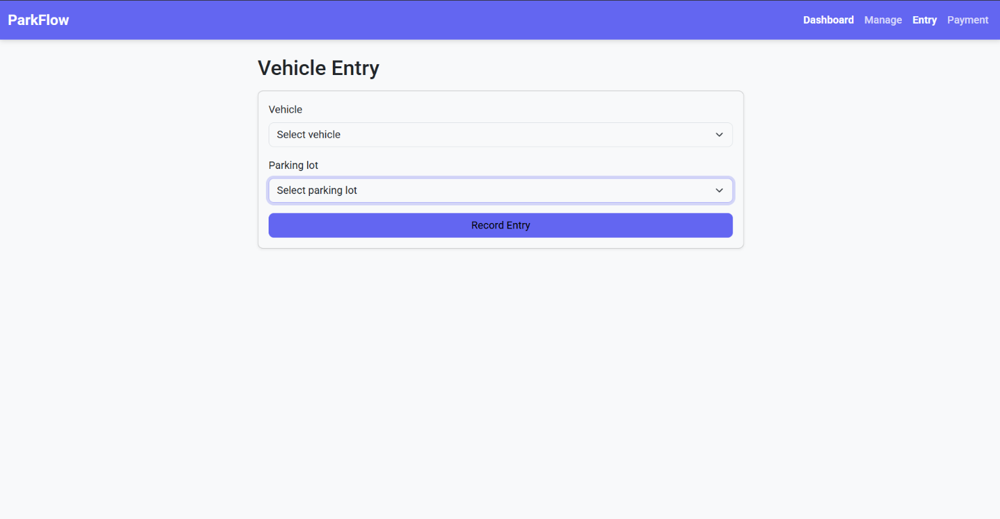
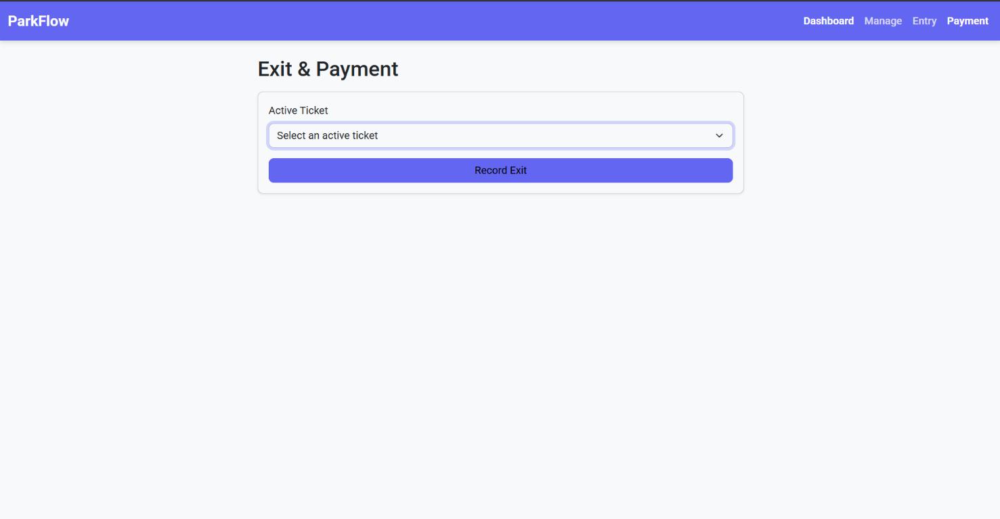

# ParkFlow - A parking management system

Full-stack parking lot management system built for real-world parking operations in malls and metro stations.

ParkFlow manages parking lots, vehicle-compatible slots, registered vehicles, ticket lifecycles, fee calculation, payments, and PDF receipts through a Spring Boot REST API and React dashboard.

## Highlights

- Parking lot and slot management
- Two-wheeler and four-wheeler support
- Automatic slot assignment on vehicle entry
- Active ticket tracking
- Exit fee calculation and payment processing
- Cash, Card, and UPI payment modes
- Context-aware PDF entry slips and receipts
- Swagger/OpenAPI documentation
- Responsive Bootstrap-based React interface

## Tech Stack

| Layer | Technologies |
| --- | --- |
| Backend | Java 21, Spring Boot 3.5, Spring Data JPA, Lombok, Maven |
| Database | PostgreSQL |
| Frontend | React 19, Vite, React Router, Axios |
| UI | Bootstrap 5, Sass/SCSS, Roboto |
| Documents/API | iText 7.2.5, Springdoc OpenAPI 2.8.8 |

## Architecture

```text
React + Vite frontend
          │
          │ REST / JSON
          ▼
Spring Boot backend
          │
          ▼
PostgreSQL database
```

Core domain entities:

```text
ParkingLot ──< ParkingSlot
Vehicle ──< ParkingTicket >── ParkingSlot
```

## Database Schema

The PostgreSQL database contains four core tables:

### `ParkingLot`

| Column | Type | Constraints / Values |
| --- | --- | --- |
| `id` | Long | Primary key, auto-generated |
| `name` | String | |
| `location` | String | |
| `totalCapacity` | Integer | |
| `status` | Enum | `ACTIVE`, `INACTIVE` |

### `ParkingSlot`

| Column | Type | Constraints / Values |
| --- | --- | --- |
| `id` | Long | Primary key, auto-generated |
| `slotNumber` | Integer | |
| `type` | Enum | `TWO_WHEELER`, `FOUR_WHEELER` |
| `status` | Enum | `FREE`, `OCCUPIED`, `RESERVED` |
| `lotId` | Long | Foreign key to `ParkingLot` |

### `Vehicle`

| Column | Type | Constraints / Values |
| --- | --- | --- |
| `id` | Long | Primary key, auto-generated |
| `ownerName` | String | |
| `model` | String | |
| `registrationNumber` | String | Unique |
| `type` | Enum | `TWO_WHEELER`, `FOUR_WHEELER` |

### `ParkingTicket`

| Column | Type | Constraints / Values |
| --- | --- | --- |
| `id` | Long | Primary key, auto-generated |
| `entryTime` | LocalDateTime | |
| `exitTime` | LocalDateTime | Nullable until exit |
| `fee` | BigDecimal | Nullable until exit |
| `paymentMode` | Enum | `CASH`, `CARD`, `UPI` |
| `paymentStatus` | Enum | `PENDING`, `PAID` |
| `status` | Enum | `ACTIVE`, `CLOSED` |
| `vehicleId` | Long | Foreign key to `Vehicle` |
| `slotId` | Long | Foreign key to `ParkingSlot` |

## Ticket Lifecycle

```text
Vehicle entry
      ↓
ACTIVE ticket + slot assigned
      ↓
Vehicle exit + fee calculated + slot released
      ↓
Payment completed
      ↓
CLOSED ticket + receipt PDF
```

Fee rules:

- First 30 minutes: free
- Two-wheeler: ₹10/hour, capped at ₹50/day
- Four-wheeler: ₹20/hour, capped at ₹100/day

## Project Structure

```text
Project2/
├── parking-management-backend/
└── parking-management-frontend/
```

Detailed documentation:

- [Backend README](./parking-management-backend/README.md)
- [Frontend README](./parking-management-frontend/README.md)
- [Frontend screenshots](./parking-management-frontend/docs/screenshots/)

## Quick Start

### 1. Start the backend

Requirements:

- Java 21
- PostgreSQL
- Database configured for the backend

From `parking-management-backend`:

```bash
./mvnw spring-boot:run
```

On Windows:

```powershell
.\mvnw.cmd spring-boot:run
```

The API starts at:

```text
http://localhost:8080/api
```

Swagger UI:

```text
http://localhost:8080/swagger-ui/index.html
```

### 2. Start the frontend

From `parking-management-frontend`:

```bash
npm install
npm run dev
```

The frontend starts at:

```text
http://localhost:5173
```

Useful frontend commands:

```bash
npm run lint
npm run build
```

## Main Screens

| Route | Purpose |
| --- | --- |
| `/` | Dashboard metrics and active tickets |
| `/manage` | Parking lots, parking slots, and vehicles |
| `/entry` | Vehicle entry and slot assignment |
| `/exit` | Vehicle exit, payment, and PDF receipt |

## API Overview

| Area | Endpoint |
| --- | --- |
| Parking lots | `/api/parking-lots` |
| Parking slots | `/api/parking-slots` |
| Vehicles | `/api/vehicles` |
| Active tickets | `/api/tickets/active` |
| Vehicle entry | `POST /api/tickets/entry` |
| Vehicle exit | `PUT /api/tickets/{id}/exit` |
| Payment | `PUT /api/tickets/{id}/pay` |
| Ticket PDF | `GET /api/tickets/{id}/pdf` |

## Screenshots









