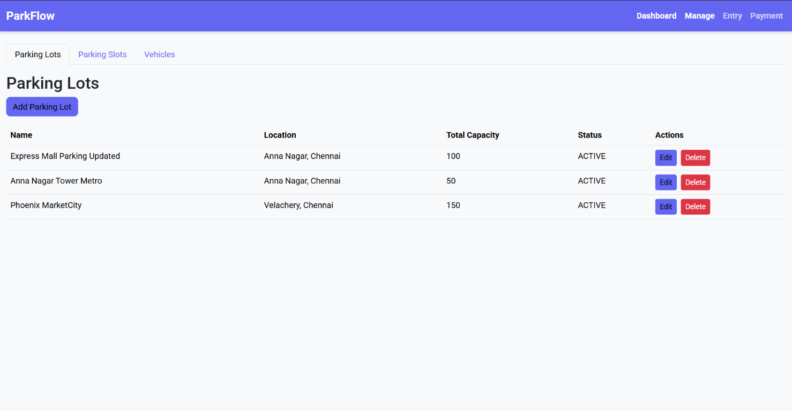
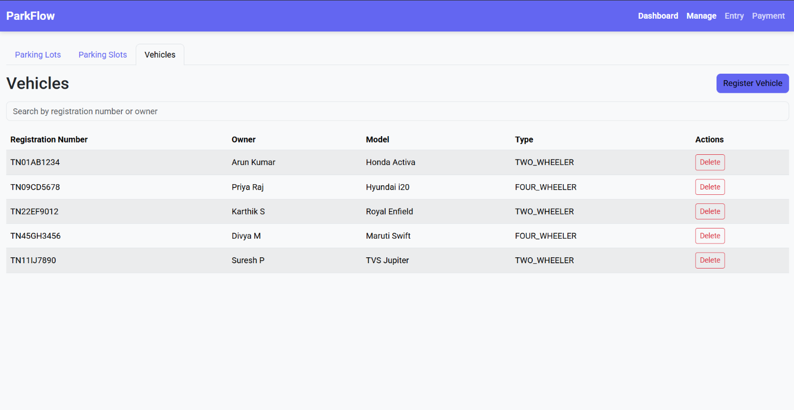

# ParkFlow Frontend

The ParkFlow frontend is a React-based user interface for the ParkFlow parking lot management system. It provides dashboard monitoring, parking-lot administration, parking-slot management, vehicle registration, vehicle entry, vehicle exit, payment processing, and ticket PDF downloads.

ParkFlow models parking operations commonly found in Chennai malls and metro stations. The frontend is designed to work with the Spring Boot backend in the sibling `parking-management` project.

## Project Status

| Area | Status |
| --- | --- |
| Dashboard | Complete |
| Parking-lot management | Complete |
| Parking-slot management | Complete |
| Vehicle management | Complete |
| Vehicle entry workflow | Complete |
| Exit and payment workflow | Complete |
| Ticket PDF download | Complete |
| Backend Swagger/OpenAPI | Complete |
| Formal project report | Planned |

## Technology Stack

- React 19
- Vite
- React Router
- Axios
- Bootstrap 5
- Sass/SCSS
- Roboto font
- ESLint

## Requirements

- Node.js and npm
- Spring Boot backend running on `http://localhost:8080`
- PostgreSQL configured for the backend

The frontend Axios client uses:

```text
http://localhost:8080/api
```

The backend CORS configuration allows the Vite development server at:

```text
http://localhost:5173
```

## Getting Started

Install dependencies:

```bash
npm install
```

Start the development server:

```bash
npm run dev
```

Create a production build:

```bash
npm run build
```

Run ESLint:

```bash
npm run lint
```

## Application Routes

| Route | Page | Purpose |
| --- | --- | --- |
| `/` | Dashboard | View parking capacity, available slots, and active tickets |
| `/manage` | Manage | Manage parking lots, parking slots, and vehicles |
| `/entry` | Vehicle Entry | Assign a free slot and create an active parking ticket |
| `/exit` | Exit & Payment | Record exit, calculate the fee, process payment, and download the receipt |

## Frontend Features

### Dashboard

The dashboard displays:

- Total parking lots
- Total parking slots
- Available slots
- Active tickets
- Active ticket details including vehicle, slot, lot, entry time, and payment status

### Parking Lots

The Parking Lots tab supports:

- Listing parking lots
- Adding a parking lot
- Editing a parking lot
- Deleting a parking lot
- Parking-lot status selection

### Parking Slots

The Parking Slots tab supports:

- Listing slots and their parking lots
- Adding and editing slots
- Deleting slots
- Filtering by parking lot
- Filtering by vehicle type
- Filtering by slot status
- Displaying free and occupied status badges

### Vehicles

The Vehicles tab supports:

- Registering vehicles
- Listing vehicle registration numbers, owners, models, and types
- Searching by registration number or owner
- Deleting vehicles
- Two-wheeler and four-wheeler vehicle types

### Vehicle Entry

The entry workflow:

1. Loads registered vehicles and active parking lots.
2. Lets the operator select a vehicle and parking lot.
3. Requests entry from the backend.
4. Assigns an available slot based on vehicle type.
5. Displays the created ticket and assigned slot.

### Exit and Payment

The exit workflow:

1. Loads existing active ticket IDs in a dropdown.
2. Records the selected vehicle's exit.
3. Displays the calculated parking fee.
4. Accepts Cash, Card, or UPI payment.
5. Closes the ticket after payment.
6. Downloads the context-aware ticket PDF.

The backend fee rules are:

- First 30 minutes: free
- Two-wheeler: ₹10/hour, capped at ₹50/day
- Four-wheeler: ₹20/hour, capped at ₹100/day

## Backend API Integration

The shared Axios instance and API helpers are in [`src/api/api.js`](./src/api/api.js).

| Feature | Endpoint |
| --- | --- |
| Parking lots | `/api/parking-lots` |
| Parking slots | `/api/parking-slots` |
| Vehicles | `/api/vehicles` |
| Active tickets | `/api/tickets/active` |
| Vehicle entry | `POST /api/tickets/entry` |
| Vehicle exit | `PUT /api/tickets/{id}/exit` |
| Payment | `PUT /api/tickets/{id}/pay` |
| Ticket PDF | `GET /api/tickets/{id}/pdf` |

## Project Structure

```text
src/
├── api/
│   └── api.js
├── components/
│   ├── LotsTab.jsx
│   ├── Navbar.jsx
│   ├── SlotsTab.jsx
│   ├── StatCard.jsx
│   └── VehiclesTab.jsx
├── pages/
│   ├── DashboardPage.jsx
│   ├── EntryPage.jsx
│   ├── ExitPaymentPage.jsx
│   └── ManagePage.jsx
├── styles/
│   └── main.scss
├── App.jsx
├── index.css
└── main.jsx
```

## Screenshots

### Dashboard


### Parking Lots



### Parking Slots


### Vehicles



### Vehicle Entry


### Exit and Payment


## Styling

The frontend uses Bootstrap with SCSS customization. The design uses:

- Indigo primary accent: `#6366F1`
- Light background: `#F8F9FA`
- Roboto typography
- Bootstrap cards, tables, tabs, badges, modals, and form controls

Global styling is loaded from [`src/styles/main.scss`](./src/styles/main.scss).

## Related Backend

The Spring Boot backend is located in the sibling `parking-management` directory. It provides the REST API, PostgreSQL persistence, parking business rules, ticket lifecycle management, PDF generation, global exception handling, and Swagger/OpenAPI documentation.

Swagger UI is available when the backend is running at:

```text
http://localhost:8080/swagger-ui/index.html
```
